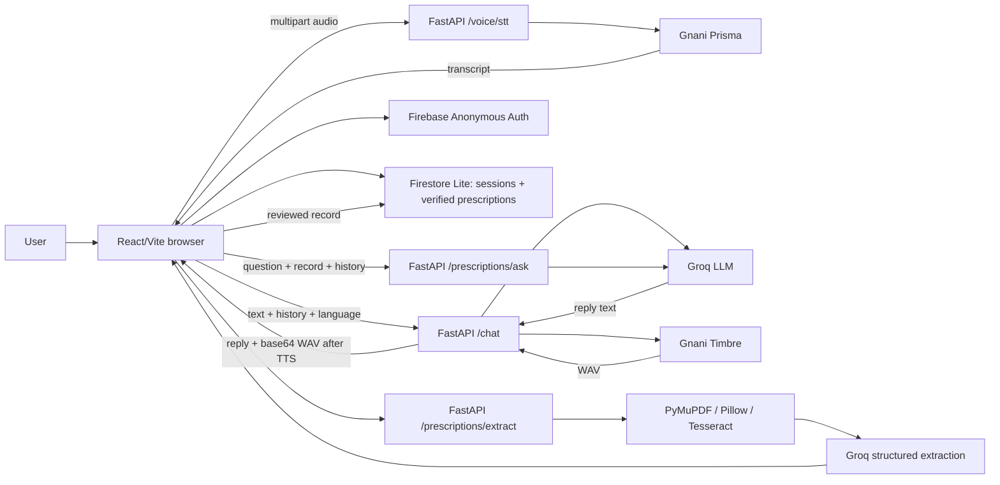

# Arogya Voice – AI Development Context

Use this document as the project handoff for a fresh coding-assistant session. It is based on the current repository source and does not depend on earlier chat history. The checkout root is `C:\Users\HP\Documents\Codex\ArogyaVoice` on the inspected workstation; use the actual open workspace path if it differs.

## 1. Project Identity

Arogya Voice is a multilingual healthcare assistance prototype for English, Kannada, Telugu and Hindi. It explores typed/spoken access to cautious general health information and assistance reading prescriptions. It is not a clinician or a production health-data system. A useful project tagline is “A prototype for health guidance in the language you speak.”

Use synthetic patient and prescription data. There are no clinician-reviewed triage rules and no validated diagnosis/emergency model.

## 2. Current Development Status

### Implemented

- Open welcome form and language selection. No OTP/password. Patient name is held in UI state; phone and Ayushman fields are not read into state or used for authentication.
- Main chat for `en`, `kn`, `te`, `hi`; React keeps recent context in memory and sends at most 16 turns to `/chat`.
- Browser microphone input → WAV conversion → Gnani Prisma `/voice/stt` → transcript → `/chat`.
- Main `/chat` backend flow: Groq answer → Gnani Timbre TTS → JSON with text and base64 WAV only after successful audio. Frontend reveals text only after the combined response and attempts autoplay. TTS-only retry and explicit text-only reveal are available if TTS fails.
- Main chat playback reuses the same browser-memory audio on Play/Pause/Resume/Restart/Stop. Autoplay denial leaves a Play fallback. Main-chat sentence highlight is approximate based on duration/text length, not word-aligned.
- Firebase Anonymous Authentication and Firestore Lite in the browser; stores only session metadata and user-reviewed prescription records, if correctly configured.
- Prescription upload, preview, OCR/text extraction, Groq structured draft, user verification, cabinet save/list/delete, and Groq Q&A on verified structured details.
- A reusable `SpeechPlayback.jsx` also has a user-initiated sentence-by-sentence TTS mode used by prescription Q&A. This flow remains distinct from main chat’s combined response.

### Partially implemented / not done

- Some Prescription Intelligence secondary UI text remains English.
- TTS voice/language/account entitlements, current Groq model availability and Firebase Console state require local verification.
- No actual login tied to welcome fields; Firebase identity is anonymous and unrelated to entered details.
- No doctor-reviewed triage, deterministic emergency escalation, autonomous diagnosis/prescribing, production auth, rate limiting, CI, hosting/deployment or monitoring.
- OCR can fail on handwriting and needs separately installed Tesseract language data.

See `docs/FEATURE_STATUS.md` for the complete status checklist and limits.

## 3. Technology Stack

- Frontend: JavaScript, React 19.3.1, React DOM 19.3.1, Vite 8.3.7, CSS.
- Backend: Python (inspected venv 3.14.7), FastAPI, Uvicorn, Pydantic, httpx, python-dotenv, python-multipart.
- AI: Groq Python SDK 1.7.0. `GROQ_MODEL` source default is `qwen/qwen3.8-27b`; verify support in the account. Used for health chat, prescription extraction and prescription Q&A.
- Speech: Gnani Prisma STT (`prisma-v3.0`) and Timbre TTS (`timbre-v3.0`). Requests use direct `httpx` REST calls; the Gnani Vachana Python SDK link is reference material only and is not installed/used by current code.
- Persistence/auth: Firebase JS SDK 12.5.0, Anonymous Auth, Firestore Lite, owner rules in `firestore.rules`.
- Prescription document processing: PyMuPDF, Pillow, pytesseract and separately installed Tesseract OCR.
- Tests: Vitest 4.1.12, jsdom 27.0.1, Testing Library; pytest 9.2.0 in inspected venv. Exact versions vary; see dependency files and `PROJECT_DOCUMENTATION.md`.

## 4. Repository Structure

```text
ArogyaVoice/
├── .env.example                      Root env example; Gnani URL entries here are currently unused
├── .gitignore                        Ignores env files, venvs, node_modules and generated build output
├── Arogya_Voice_Solution_Pitch.txt   Existing project pitch; not used by runtime
├── package.json / package-lock.json  Separate root npm manifest/lockfile
├── backend/
│   ├── app/main.py                    FastAPI routes, Groq chat, Prisma/Timbre and audio checks
│   ├── app/ocr_service.py             PDF/image validation and OCR
│   ├── app/prescription_models.py     Pydantic data/request schemas
│   ├── app/prescription_extractor.py  Groq OCR-to-structured-draft extraction
│   ├── app/prescription_assistant.py  Groq prescription Q&A
│   ├── app/prescription_routes.py     /prescriptions endpoints
│   ├── requirements.txt               Python dependencies (mostly unpinned)
│   ├── .env.example                   Backend environment template (safe placeholders)
│   └── tests/                         Synthetic OCR and mocked-provider tests
├── frontend/
│   ├── src/App.jsx                    Welcome/language/chat, STT and /chat integration
│   ├── src/firebase.js                Anonymous Auth, session and cabinet Firestore operations
│   ├── src/PrescriptionWorkspace.jsx  Cabinet/upload/review/ask UI
│   ├── src/SpeechPlayback.jsx         Reusable localized audio controls/player
│   ├── src/*.css                      Main, prescription and playback styling
│   ├── src/SpeechPlayback.test.jsx    Playback component tests
│   ├── index.html                      Vite HTML entry point
│   ├── package.json / package-lock.json Vite app manifest, scripts and lockfile
│   └── .env.example                   Frontend-only Vite config template
├── docs/API_REFERENCE.md              Actual HTTP contracts
├── docs/DEVELOPMENT_SETUP.md          Windows setup and troubleshooting
├── docs/FEATURE_STATUS.md              Source-based completion checklist
├── firestore.rules                    Owner-scoped security rules
├── package.json                       Separate root manifest (not needed for Vite start)
├── README.md                          Project overview/quick setup
├── PROJECT_DOCUMENTATION.md           Detailed system reference
└── AI_CONTEXT.md                      This handoff
```

## 5. System Architecture



Firebase calls are from the browser, constrained by Firestore rules. No backend Firebase Admin SDK is present.

## 6. Core Application Workflows

### Welcome and language

`App` uses conditional React state rather than a router. The welcome form is open. Its handler reads only the patient name; phone/card numbers are not saved. Selecting a language stores the code in React state, seeds a localized greeting and attempts Firebase session metadata creation.

### Text question

React posts `{language,message,history}` to `/chat`. Backend validates, builds a multilingual safety prompt, asks Groq and sends the generated text to Timbre. Successful response returns `{reply,model,voice_status:"ready",audio_base64,audio_content_type}`. The UI displays the reply and attempts autoplay only after this response. On TTS failure, backend returns `voice_status:"failed"` plus reply internally; UI hides it and offers Retry Audio or View Text Only. Retry calls `/voice/tts`, so no Groq call is repeated.

### Voice question

Browser `MediaRecorder` records up to 30 seconds. `blobToWav` converts to mono WAV. The browser posts `audio_file` and selected language to `/voice/stt`; after Prisma transcription, the transcript goes through the exact same `/chat` combined Groq+TTS flow.

### Prescription Intelligence

Upload PDF/JPG/JPEG/PNG (max 10 MiB, PDF max 8 pages). Backend extracts text or OCRs with Tesseract/Pillow, then Groq creates a nullable structured draft; status remains `needs_review`. User compares/edits each medicine and checks every row before confirmation. Verified details save to Firestore when configured. Q&A sends the verified structured record, question and short client-memory history to `/prescriptions/ask`. Prescription replies currently appear as text with a separate manual Play button that synthesizes each sentence through `/voice/tts`.

## 7. API Integrations

### Groq

Called from Python only using `AsyncGroq`; key variable is `GROQ_API_KEY`. The model uses `GROQ_MODEL`, default `qwen/qwen3.8-27b`. Health chat: temperature 0.3, 450 max completion tokens. Prescription extraction: JSON mode, temperature 0, 1200 tokens, OCR prompt truncated to 12,000 characters. Prescription Q&A: temperature 0.2, 500 tokens. Client timeout 45 seconds and `max_retries=1`. No model-availability check.

### Gnani Prisma

`POST https://api.vachana.ai/stt/v3`; `X-API-Key-ID` from `GNANI_API_KEY`; multipart `audio_file`, `model=prisma-v3.0`, `language_code=en-IN|kn-IN|te-IN|hi-IN`. Expected JSON has `success`, `transcript`, optionally `detected_language_code`.

### Gnani Timbre

`POST https://api.vachana.ai/api/v1/tts/inference`; same `X-API-Key-ID` header; JSON specifies `text`, `model=timbre-v3.0`, `voice=Shivani`, selected locale, speed 1.0, mono 48 kHz 16-bit linear PCM in WAV container. Backend validates the returned WAV.

### Firebase

Frontend Vite config names: `VITE_FIREBASE_API_KEY`, `VITE_FIREBASE_AUTH_DOMAIN`, `VITE_FIREBASE_PROJECT_ID`, `VITE_FIREBASE_STORAGE_BUCKET`, `VITE_FIREBASE_MESSAGING_SENDER_ID`, `VITE_FIREBASE_APP_ID`. All six must be non-empty for Firebase init. App calls Anonymous Auth, writes `sessions/{id}` metadata and CRUDs `prescriptions/{id}`. Only an anonymous Firebase UID links records to an owner; welcome details do not. Enable Anonymous Auth, create Firestore and publish `firestore.rules` manually.

## 8. Environment Configuration

| Name | Used by | Meaning |
|---|---|---|
| `GROQ_API_KEY` | Backend | Groq secret. |
| `GROQ_MODEL` | Backend | Model name; source default `qwen/qwen3.8-27b`. |
| `GNANI_API_KEY` | Backend | Gnani secret for both Prisma and Timbre. |
| `FRONTEND_ORIGINS` | Backend | Allowed browser origins for CORS. |
| `TESSERACT_CMD` | Backend OCR | Optional Tesseract executable path. |
| `TESSDATA_PREFIX` | Tesseract process config | Appears in sample; Python source does not read it explicitly. |
| `VITE_API_BASE_URL` | Frontend | FastAPI base URL. |
| `VITE_FIREBASE_API_KEY` | Frontend | Firebase web config. Not a service-account secret. |
| `VITE_FIREBASE_AUTH_DOMAIN` | Frontend | Firebase web config. |
| `VITE_FIREBASE_PROJECT_ID` | Frontend | Firebase web config. |
| `VITE_FIREBASE_STORAGE_BUCKET` | Frontend | Required by current all-fields readiness check; Storage itself is unused. |
| `VITE_FIREBASE_MESSAGING_SENDER_ID` | Frontend | Firebase web config. |
| `VITE_FIREBASE_APP_ID` | Frontend | Firebase web config. |
| `GNANI_STT_URL`, `GNANI_TTS_URL` | None | Blank entries in root `.env.example`; unused by source, which hardcodes provider URLs. |

Never paste/commit `.env` values. Copy safe templates and enter fresh rotated credentials locally.

## 9. Running the Application

At repository root in PowerShell:

```powershell
python -m venv .venv
.\.venv\Scripts\Activate.ps1
python -m pip install --upgrade pip
pip install -r backend\requirements.txt
Copy-Item backend\.env.example backend\.env
Copy-Item frontend\.env.example frontend\.env.local
```

Fill environment files; enable Firebase Anonymous Auth, create Firestore and publish the root rules. Backend terminal at repo root:

```powershell
python -m uvicorn app.main:app --reload --app-dir backend
```

Frontend terminal:

```powershell
cd frontend
npm install
npm run dev
```

Open Vite's printed URL (usually `http://localhost:5173`); backend health is `http://127.0.0.1:8000/health`. Full instructions and tests are in `docs/DEVELOPMENT_SETUP.md`.

## 10. Important Development Decisions

- Preserve current Groq and Gnani calls and their documented request formats. No secrets belong in React/Vite code.
- Main chat deliberately waits for TTS before showing the generated text. On audio error the UI requires explicit Retry Audio or View Text Only; a retry must not call Groq.
- Main chat audio is base64 in one response, decoded to a Blob in browser memory; no audio is persisted or publicly hosted.
- Prescription Q&A uses a different text-first, user-initiated sentence TTS path today. Do not silently change it while modifying main chat.
- The current chat history is sent by the client, not loaded from a server-side conversation store.
- Prescription extraction is a draft. Do not treat model confidence or client status `verified` as clinical certification.
- `firestore.rules` is the actual data boundary; Firebase setup is manual and must be tested against a non-production project.
- `frontend/package.json` is the Vite app manifest. The root package manifest is separate.

## 11. Known Issues and Limitations

- No doctor-reviewed triage or independently validated emergency escalation; the model can still produce incorrect guidance.
- No production authentication/identity or recovery. The open form is not an account login.
- Main-chat sentence highlighting is estimated, because the REST audio response has no timings. Autoplay may be blocked by the browser.
- Prescription secondary UI strings are partly English. OCR requires host-installed Tesseract/data; scan/handwriting errors are possible.
- Firebase data persists only if all web config fields, anonymous provider, database and rules are configured correctly. Anonymous identity may be lost if browser storage is cleared.
- Backend routes do not authenticate callers or rate-limit usage. CORS only controls browsers.
- Provider/API keys and model access are not verified by source. Verify with synthetic inputs in local development.
- This inspected workspace had frontend test/build success. Backend test source compiles, but this documentation run could not complete pytest because Python's Windows event-loop startup hung in the current environment; rerun in the developer's normal local environment.
- Dependencies are mostly unpinned in Python and some npm manifests use `latest`; lockfiles govern the resolved frontend package set until regenerated.

## 12. Development Rules for Future AI Assistants

- Always inspect the existing implementation before modifying it.
- Never rewrite working components unnecessarily.
- Preserve existing Groq and Gnani integrations.
- Do not replace Gnani Prisma or Timbre without explicit permission.
- Never expose API keys or credentials.
- Keep backend and frontend responsibilities separate.
- Use modular, maintainable code.
- Do not claim features work without testing them.
- Maintain multilingual functionality.
- Do not fabricate medical or prescription information.
- Distinguish implemented features from planned features.
- Explain important changes and identify modified files.
- Give exact commands for new dependencies and configuration.
- Do not delete existing functionality without permission.

## 13. How to Continue Development

1. Read this file, `PROJECT_DOCUMENTATION.md`, `docs/FEATURE_STATUS.md` and the relevant source module before editing.
2. Check `git status` and preserve unrelated/uncommitted user work. Do not push without the user's explicit request.
3. Never read or quote `backend/.env` or frontend local env files; use only the `.env.example` variable names.
4. Make a focused change in the existing module. Keep Groq/Gnani credentials backend-only and preserve the separate prescription workflow unless its scope is explicitly changed.
5. Run frontend `npm test`/`npm run build` or backend tests as appropriate. State when live integrations are mocked or provider credentials were not tested.
6. For medical behavior, do not add clinical advice as if validated. Require clinician-authored review for any triage policy.

The complete route list and JSON/multipart contracts are in `docs/API_REFERENCE.md`; setup, Firebase console steps and troubleshooting are in `docs/DEVELOPMENT_SETUP.md`.
