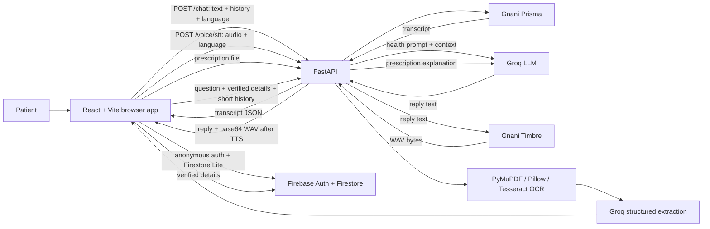

# Arogya Voice

**A prototype for health guidance in the language you speak.**

Arogya Voice is a multilingual healthcare assistance prototype for English, Kannada, Telugu and Hindi. It combines a React web interface, a FastAPI service, Groq language-model calls, Gnani Prisma speech recognition and Gnani Timbre speech synthesis. A separate Prescription Intelligence workspace helps users read, review and organize prescription details. It is a prototype, not a clinical service.

## Purpose

**Problem explored:** people who prefer Kannada, Telugu, Hindi or English may find it harder to describe a concern or understand general health information through a text-only, single-language interface. Prescription printouts can also be difficult to read.

**Proposed solution:** a prototype that accepts typed or spoken concerns, replies in a selected language, speaks the reply, and offers OCR-assisted prescription reading followed by patient review.

**Objectives:** demonstrate a multilingual text/voice flow; keep provider secrets on the Python backend; avoid storing chat text and recordings; make prescription extraction reviewable before saving; and clearly show that AI guidance is not a diagnosis or prescription.

**Target users:** people exploring the prototype who prefer English, Kannada, Telugu or Hindi. Use synthetic demo information only.

The assistant must not diagnose, prescribe, recommend medication doses, or replace a qualified clinician. Its safety instructions are prompt-level safeguards; they are not doctor-reviewed triage rules or a clinical decision system.

## Features and status

| Feature | Current status |
|---|---|
| Open welcome form and language selection | Implemented; no OTP/password. Only the entered patient name is used in UI state. Phone and card fields are not persisted or used for authentication. |
| English, Kannada, Telugu and Hindi | Implemented for the primary conversation, speech locales and playback labels. Some secondary prescription UI copy remains English. |
| Text health conversation | Implemented through FastAPI `/chat`; short history is held in browser memory and submitted with each request. |
| Voice health conversation | Implemented as browser recording → Prisma transcription → `/chat`; the app converts the recording to WAV first. |
| Groq response generation | Implemented through the official Python SDK; model is configurable with a code default. |
| Timbre audio for main chat | Implemented as part of `/chat`; the reply and base64 WAV return together after TTS succeeds, then the browser attempts autoplay. |
| Playback controls and sentence highlighting | Implemented. Chat reuses its in-memory audio for controls. Main-chat highlighting estimates sentence progress because the returned WAV has no alignment timestamps. Prescription Q&A retains the separate user-initiated sentence-audio path. |
| Firebase Authentication and Firestore | Implemented in the browser using Anonymous Authentication and Firestore Lite, when configured. |
| Session metadata | Implemented: owner ID, language, creation timestamp and last activity timestamp. Chat text/audio are not saved by this app. |
| Prescription upload, OCR and extraction | Implemented for PDF/JPG/JPEG/PNG with size/page limits; results are an unverified draft and require user review. OCR needs the external Tesseract program. |
| Medicine verification and cabinet | Implemented. Saving is gated by a user review checkbox for each medicine; records are written to the owner’s Firestore cabinet when Firebase is configured. |
| Prescription Q&A | Implemented using Groq and the verified structured details plus in-memory context. It is instructed not to alter medication directions. |
| Doctor-reviewed triage, diagnosis or prescribing | Not implemented. The application must not be treated as clinical software. |
| Production identity, hosting, monitoring or deployment automation | Not established in this repository. |

## Technology stack

| Area | Technology | Role |
|---|---|---|
| Frontend | React 19, Vite 8, JavaScript, CSS | Patient UI, language state, recording and playback. |
| Backend | Python 3.14 environment, FastAPI, Uvicorn | Validates requests and orchestrates providers and document processing. |
| LLM | Groq Python SDK; default model string `qwen/qwen3.8-27b` | Health reply, prescription extraction and prescription Q&A. Availability of this model on the configured Groq account must be verified at runtime. |
| STT | Gnani Prisma REST API | Converts patient audio to a transcript. |
| TTS | Gnani Timbre REST API | Produces WAV speech audio. |
| Identity/database | Firebase Anonymous Authentication, Cloud Firestore Lite | Browser identity and owner-scoped session metadata/prescription records. |
| OCR/PDF | Tesseract OCR, pytesseract, Pillow, PyMuPDF | Reads image and PDF prescription text. Tesseract is a separate system install. |
| Tests | Vitest, Testing Library, pytest | Frontend playback tests and backend/OCR/provider-mock tests. |

The installed package versions and declared version ranges are documented in [PROJECT_DOCUMENTATION.md](PROJECT_DOCUMENTATION.md). Python requirements are mostly unpinned.

## Architecture



Firebase is contacted directly by the browser. The FastAPI backend does not use an Admin SDK or write to Firestore. The main chat orchestration returns one JSON response containing the assistant text and its base64-encoded WAV after TTS succeeds. On TTS failure, the backend response contains the text with `voice_status: "failed"`; the UI keeps that text hidden until the patient retries TTS or explicitly chooses text-only.

## Quick setup (Windows)

Requirements: Python (the inspected environment used 3.14.7), Node/npm (inspected as Node 23.3.0 and npm 11.13.0), Git, and optionally Tesseract for prescription OCR.

```powershell
git clone https://github.com/cdd404/ArogyaVoice.git
cd ArogyaVoice
python -m venv .venv
.\.venv\Scripts\Activate.ps1
python -m pip install --upgrade pip
pip install -r backend\requirements.txt
Copy-Item backend\.env.example backend\.env
Copy-Item frontend\.env.example frontend\.env.local
```

Fill local environment files with your own provider keys and Firebase web-app configuration. Enable Firebase Anonymous Authentication, create Firestore, and publish [firestore.rules](firestore.rules). Never commit `.env` or send API keys in chat.

Backend terminal, from the repository root:

```powershell
\.venv\Scripts\python.exe -m uvicorn app.main:app --reload --app-dir backend
```

Frontend terminal:

```powershell
cd frontend
npm install
npm run dev
```

Open the Vite URL printed in the terminal, usually http://localhost:5173. Full setup, Firebase setup, OCR prerequisites and test commands are in [docs/DEVELOPMENT_SETUP.md](docs/DEVELOPMENT_SETUP.md).

## Project layout

```text
ArogyaVoice/
├── backend/                 FastAPI, provider integrations, prescription services and tests
├── frontend/                React/Vite app and UI tests
├── docs/                    API, setup and feature-status references
├── firestore.rules          Firestore owner/security rules
├── README.md                Project overview and quick start
├── PROJECT_DOCUMENTATION.md Detailed technical reference
└── AI_CONTEXT.md            Context for a fresh AI development session
```

See [AI_CONTEXT.md](AI_CONTEXT.md) to continue work in another coding assistant without prior chat history.

## Privacy and security notes

- Groq and Gnani secrets belong only in `backend/.env`; React never receives those credentials. The Firebase web configuration is a browser app configuration, not a service-account key; Firestore rules must be published and tested.
- Firebase uses an anonymous account, independent of the open welcome form. The name is retained in UI state; phone and Ayushman card fields are not read into application state. Session data contains only owner ID, language and timestamps.
- Chat history is kept in React state and sent to Groq through the backend; chat text, STT recordings and TTS audio are not written to Firestore by this app. The browser temporarily holds audio in memory for playback.
- Prescription source files are sent to FastAPI for in-memory parsing/OCR and are not uploaded to Firebase Storage. Only reviewed structured prescription details are saved to Firestore. Prescription Q&A text is sent to Groq and kept in component memory, not stored as a transcript.
- Use synthetic demo information. Anonymous browser identity can be lost when browser data is cleared. This setup is not a production health-data system.

## Known gaps

No clinician-reviewed triage policy or deterministic emergency classifier is present. The LLM prompt is a safeguard, not a guarantee. Tesseract and each requested language pack must be installed on the host; handwriting may be unreadable. Secondary prescription interface text is only partly translated. Main-chat sentence highlighting is an estimate, not provider-supplied timing. Confirm current Groq model availability, Gnani account entitlements, Firebase project configuration, and deployed rules locally before using the integrations.

## References

- [Gnani Prisma STT documentation](https://docs.gnani.ai/api/STT/speech-to-text)
- [Gnani Timbre TTS documentation](https://docs.gnani.ai/api/TTS/tts-inference)
- [Gnani Python SDK](https://github.com/Gnani-AI-Mintlify/Gnani-Vachana)
